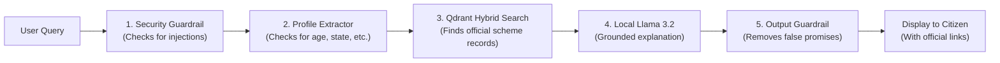

# 🇮🇳 Scheme Finder

**Verified Government Scheme Eligibility Assistant**

Scheme Finder helps citizens in India—especially women, students, and low-income families—find welfare schemes they qualify for.

The system uses two engines to prevent wrong answers:
1. **Rule Engine**: Evaluates criteria using exact 3-valued logic (`Yes`, `No`, `Unknown`). It prevents false recommendations (0% false positives).
2. **Conversational AI**: Uses a local Llama 3.2:3b model and a Qdrant vector database. It explains rules in simple language, extracts applicant details, and cites official government sources.

---

## ⚡ Quick Start

### 🍎 macOS & 🐧 Linux

1. Clone the repository and navigate into the folder:
   ```bash
   git clone https://github.com/AdinotAadi/scheme-finder-chatbot.git
   cd scheme-finder-chatbot
   ```

2. Run the automated setup script:
   ```bash
   ./setup.sh
   ```

3. Start the application:
   ```bash
   uv run streamlit run src/app.py
   ```
   *(Or activate the environment: `source .venv/bin/activate && streamlit run src/app.py`)*

---

### 🪟 Windows

1. Run `setup.bat` in Command Prompt or PowerShell:
   ```cmd
   setup.bat
   ```

2. Start the application:
   ```cmd
   call .venv\Scripts\activate.bat
   streamlit run src/app.py
   ```

The application opens in your web browser at: `http://localhost:8501`

---

## 🦙 Local AI Setup (Ollama + Llama 3.2:3b)

The assistant runs **Meta Llama 3.2:3b** locally on your computer. Your queries remain private.

1. **Install Ollama**:
   - Download from [ollama.com](https://ollama.com).
2. **Download the model**:
   ```bash
   ollama pull llama3.2:3b
   ```
3. **Keep Ollama running**:
   - Keep the Ollama application open, or run `ollama serve` in a terminal window.
   - *Note: If Ollama is not installed or stopped, Scheme Finder automatically falls back to verified direct vector matching.*

---

## 🏗️ Clean Project Structure

The project follows Clean Architecture rules. Core business logic does not depend on user interfaces or external databases.

```text
scheme-finder-chatbot/
├── src/                          # Application source code
│   ├── schema/                   # Domain Entities (Independent Core)
│   │   ├── rules.py              # SingleCriterion, CriterionGroup, UserProfile
│   │   └── review_queue.py       # Human verification schemas
│   ├── engine/                   # Business Use Cases & Logic
│   │   ├── evaluator.py          # 3-valued Kleene logic engine (0% false positives)
│   │   ├── profile_extractor.py  # User profile extraction and chat triage
│   │   ├── guardrails.py         # Prompt injection & jailbreak protection
│   │   ├── vector_store.py       # Qdrant vector store & hybrid search adapter
│   │   └── rag_pipeline.py       # End-to-end RAG orchestrator
│   ├── llm/                      # External LLM Interfaces
│   │   ├── ollama_client.py      # Local Ollama Llama 3.2 client
│   │   └── llm_interface.py      # Abstract LLM provider interface
│   ├── ingestion/                # Data Harvesting & Transformation
│   │   ├── fetch_schemes.py      # Rate-limited myScheme API harvester
│   │   └── scrape_all_schemes.py # Batch ingestion script
│   ├── app.py                    # Presentation: Streamlit Web User Interface
│   └── cli.py                    # Presentation: Command Line Interface
│
├── docs/                         # Technical Documentation
│   └── architecture/             # Architecture diagrams, C4 models & specs
│       └── ARCHITECTURE.md       # Detailed technical design document
│
├── tests/                        # Automated Test Suite (Pytest)
│   ├── test_slice0_cleaning.py   # Data validation tests
│   ├── test_slice1_ingestion.py  # Ingestion tests
│   ├── test_slice3_engine.py     # 3-valued logic engine unit tests
│   ├── test_guardrails.py        # Security & prompt injection tests
│   ├── test_profile_extractor.py # Demographic extractor tests
│   └── test_vector_store.py      # Vector search tests
│
├── scripts/                      # Setup and data maintenance scripts
│   ├── clean_seed_data.py        # Seed dataset cleaner
│   └── setup/                    # Environment bootstrap scripts
│
├── reports/                      # Verification reports & milestone evidence
├── setup.sh                      # Setup script for macOS & Linux
├── setup.bat                     # Setup script for Windows
├── pyproject.toml                # Project dependencies and configuration
└── requirements.txt              # Pinned Python dependencies
```

---

## 🛡️ How It Works (Step-by-Step Flow)



1. **Security Guardrail**: Scans the text for harmful prompt injections or jailbreaks.
2. **Profile Extractor**: Identifies citizen details (such as age, state, or pregnancy status). If required details are missing, it asks clarifying questions.
3. **Qdrant Search**: Finds relevant verified government scheme records.
4. **Local Llama 3.2**: Summarizes benefits and requirements using only official text.
5. **Output Verification**: Replaces absolute promises (e.g. "You will get ₹50,000") with safe guidance ("You may be eligible").

---

## 🧪 Testing and Verification

Run the test suite using `uv` or `pytest`:

```bash
uv run pytest tests/ -v
```

All unit tests verify:
- Data cleaning and table schemas.
- 3-valued logic calculations (checking `SATISFIED`, `NOT_SATISFIED`, and `UNKNOWN`).
- Prompt injection protection.
- Profile triage parsing.

---

## 📖 Additional Documentation

- **[System Architecture & Design (ASD-SDE Standard)](docs/architecture/ARCHITECTURE.md)**: Full block diagrams, sequence diagrams, logic flowcharts, and security threat models.
- **[Installation and Setup Guide](SETUP_GUIDE.md)**: Step-by-step instructions for troubleshooting and offline usage.
- **[Evaluation Report](reports/slice4_evaluation_report.md)**: Test results against gold-standard data showing 0% false positives.
